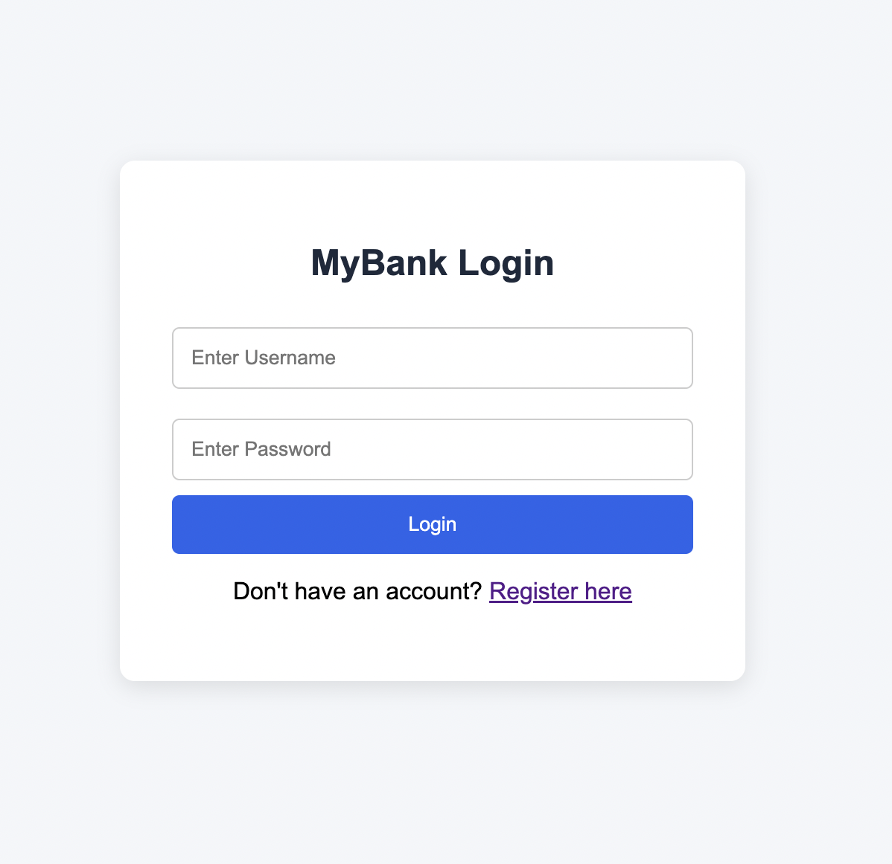
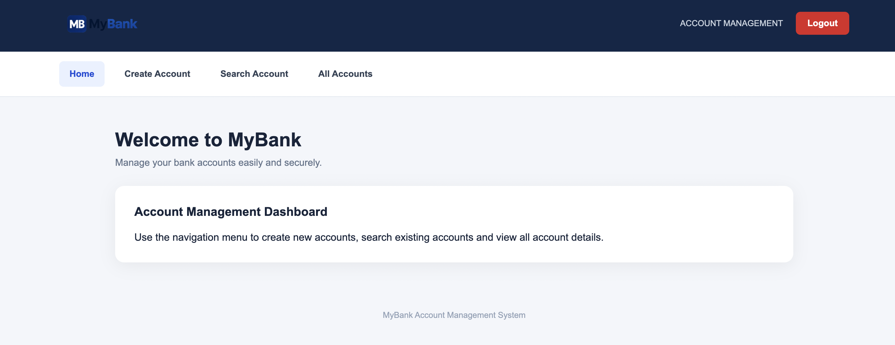
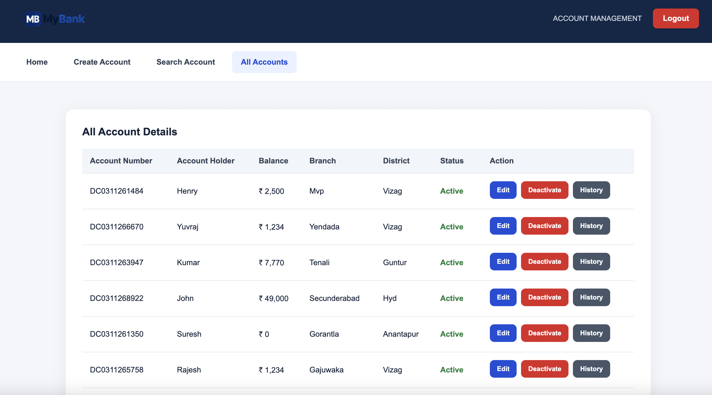
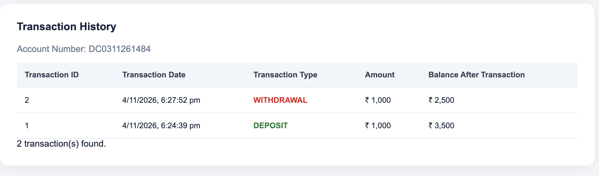

# WebDisplay – Banking Management System

A web-based banking management application built using **Java, Spring Boot, MySQL, Hibernate, and JSP**. WebDisplay provides a centralised interface for managing bank accounts, performing financial transactions, tracking transaction history, and handling user sessions.

The project focuses on implementing essential banking operations with a layered application architecture, database integration, input validation, and session-based authentication.

---

## Overview

WebDisplay is designed to simplify everyday banking management operations through an interactive web interface backed by a Spring Boot application.

Users can register and log in, create and manage bank accounts, perform deposits and withdrawals, view transaction records, and manage account information.

The application also includes account status management and session timeout handling to control access to authenticated features.

## Application Screenshots

### Login Page


### Dashboard


### Account Management


### Transaction History


## Key Features

### 1. User Authentication and Session Management
- User registration and login.
- Session-based user authentication.
- Automatic session timeout.
- Session validation for protected application requests.
- Logout with session invalidation.
- Session heartbeat mechanism to monitor active sessions.
- Multi-tab session activity handling.

### 2. Account Management
- Create new bank accounts.
- Automatically generate unique account numbers.
- Search for accounts using account details.
- View all registered accounts.
- Edit account holder information.
- Manage branch name and district information.
- Record account creation date and time.
- Activate and deactivate accounts.
- Restrict account editing and transactions for inactive accounts.

### 3. Banking Transactions
- Deposit money into an account.
- Withdraw money from an account.
- Automatically update account balances.
- Validate transaction amounts.
- Prevent withdrawals when the available balance is insufficient.
- Restrict transactions on inactive accounts.

### 4. Transaction History
- Maintain records of deposits and withdrawals.
- Retrieve transaction history for individual accounts.
- Display transaction ID and date.
- Display transaction type and amount.
- Track the account balance after each transaction.
- Display transactions in descending date order.

### 5. Account Information Management
- Maintain account holder details.
- Store account number and balance.
- Maintain branch and district information.
- Track account status.
- Store account creation timestamps.

---

## Technology Stack

| Category | Technologies |
|---|---|
| Programming Language | Java |
| Backend Framework | Spring Boot |
| Frontend | JSP, HTML, CSS, JavaScript |
| Database | MySQL |
| ORM | Hibernate |
| Data Access | Spring Data JPA |
| Build Tool | Maven |
| Web Server | Embedded Apache Tomcat |
| Development Environment | IntelliJ IDEA |

---

## Application Architecture

The application follows a layered architecture to separate request handling, business logic, data access, and presentation.

```text
              User Interface
                    |
                    v
          JSP / HTML / CSS / JS
                    |
                    v
             Controller Layer
                    |
                    v
              Service Layer
                    |
                    v
             Repository Layer
                    |
                    v
              MySQL Database
```

### Package Structure

```text
com.epdcl.webdisplay
│
├── config
│
├── controller
│   ├── AccountController
│   ├── HomeController
│   ├── LoginController
│   └── SessionController
│
├── dto
│   ├── AccountDto
│   └── TransactionDto
│
├── entity
│   ├── Account
│   ├── Transaction
│   └── User
│
├── exception
│   ├── AccountException
│   ├── ErrorDetails
│   └── GlobalExceptionHandler
│
├── filter
│   └── SessionAuthenticationFilter
│
├── mapper
│   ├── AccountMapper
│   └── TransactionMapper
│
├── repo
│   ├── AccountRepository
│   ├── TransactionRepository
│   └── UserRepository
│
└── service
    └── impl
        ├── AccountService
        ├── AccountServiceImpl
        ├── UserService
        └── UserServiceImpl
```

### Architecture Responsibilities

- **Controller Layer:** Handles incoming HTTP requests and application responses.
- **Service Layer:** Implements banking operations, validations, and business rules.
- **Repository Layer:** Communicates with the MySQL database using Spring Data JPA.
- **Entity Layer:** Represents database entities.
- **DTO Layer:** Transfers application data between layers.
- **Mapper Layer:** Converts entities into DTOs and vice versa.
- **Exception Layer:** Handles application-specific errors and exceptions.
- **Filter Layer:** Validates user sessions for protected requests.
- **Presentation Layer:** Provides the user interface through JSP pages.

---

## Database

The application uses MySQL for persistent storage.

The main database entities include:

- **User:** Stores user account information for application authentication.
- **Account:** Stores bank account details, balance, branch, district, and account status.
- **Transaction:** Maintains deposit and withdrawal transaction records associated with accounts.

Hibernate is used for ORM, while Spring Data JPA provides database access and repository operations.

---

## Getting Started

### Prerequisites

Make sure the following are installed:

- Java 17 or later
- MySQL Server
- IntelliJ IDEA (recommended)
- Git

### 1. Clone the Repository

```bash
git clone https://github.com/sathviksuhas7/WebDisplay.git
```

### 2. Open the Project

Open the cloned project in IntelliJ IDEA.

Allow Maven to load the dependencies defined in `pom.xml`.

### 3. Create the Database

Open MySQL and execute:

```sql
CREATE DATABASE webdisplay_db;
```

Create the required tables and columns according to the application's entity mappings. The application uses `spring.jpa.hibernate.ddl-auto=none`, so Hibernate does not automatically create the database tables.

### 4. Configure Database Credentials

Open:

```text
src/main/resources/application.properties
```

Configure the following properties:

```properties
spring.datasource.url=${DB_URL}
spring.datasource.username=${DB_USERNAME}
spring.datasource.password=${DB_PASSWORD}
```

Set the following environment variables in your IDE or execution environment:

```text
DB_URL=jdbc:mysql://localhost:3306/webdisplay_db
DB_USERNAME=your_mysql_username
DB_PASSWORD=your_mysql_password
```

Do not commit actual database credentials to the repository.

### 5. Run the Application

Run the Spring Boot main class:

```text
WebdisplayApplication.java
```

Alternatively, execute:

```bash
./mvnw spring-boot:run
```

### 6. Access the Application

Open your browser:

```text
http://localhost:1111
```

---

## Future Enhancements

The following features are planned for subsequent development:

- File and document upload functionality.
- Uploaded document preview.
- Scheduling functionality.

---

## Project Status

**Core banking management functionality implemented.**

The application currently supports user authentication, session management, account operations, transaction processing, and account information management.

Additional functionality is planned as part of ongoing development.

---

## Author

**O Sathvik Suhas**

Java | Spring Boot | MySQL | Backend Development

