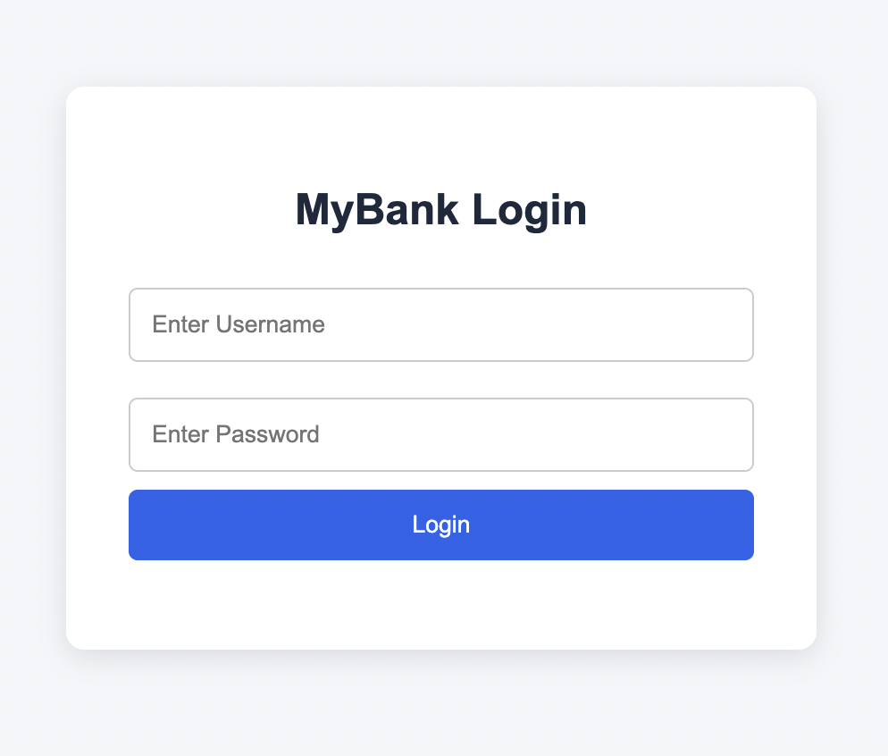

# WebDisplay – Banking Management System

A web-based banking management application developed using **Java 17, Spring Boot, Spring Security, Spring Data JPA, Hibernate, MySQL, and JSP**.

WebDisplay provides a banking interface with separate access for Admin, Employee, Customer, and Helpdesk roles. It supports banking operations, customer management, and Helpdesk workflows through a Spring Boot backend integrated with MySQL.

---

## Overview

WebDisplay is designed to manage banking operations through a web-based application.

The application includes role-based access for four user types:

- **Admin:** Access to administrative functionality.
- **Employee:** Access to permitted banking operations.
- **Customer:** Access to customer-related functionality.
- **Helpdesk:** Access to customer support and ticket management functionality.

Spring Security is used to manage authentication and role-based authorization, while session management and CSRF protection help secure application requests.

---

## Application Screenshots

### Login Page



### Dashboard


### Account Management


### Transaction History


---

## Key Features

### 1. Authentication and Security

- User login and logout.
- Session-based authentication.
- Role-based access control using Spring Security.
- CSRF token protection.
- Session validation for protected requests.
- Session invalidation during logout.
- Restricted access to application endpoints based on user roles.

### 2. Role-Based Access

The application supports four roles:

- Admin
- Employee
- Customer
- Helpdesk

Each role has access to specific application functionality. Role permissions are enforced through Spring Security and tested against protected endpoints.

### 3. Banking Operations

- Deposit money into accounts.
- Withdraw money from accounts.
- Transfer funds between accounts.
- Retrieve account information.
- Persist banking operations in MySQL.

### 4. Helpdesk Management

- Search for customers and retrieve customer details.
- View masked account information.
- Investigate customer transactions.
- Create and manage support tickets.
- Assign support tickets.
- Update ticket status.
- Add remarks and maintain ticket history.

### 5. API Development and Testing

- Developed REST APIs using Spring Boot.
- Integrated application services with MySQL using Spring Data JPA and Hibernate.
- Tested API functionality using Postman.
- Verified role-specific endpoint permissions and restricted unauthorized access.

---

## Technology Stack

| Category | Technologies |
|---|---|
| Programming Language | Java 17 |
| Backend Framework | Spring Boot |
| Web Framework | Spring Web MVC |
| Security | Spring Security, CSRF Protection |
| Persistence | Spring Data JPA |
| ORM | Hibernate |
| Frontend | JSP, HTML, CSS, JavaScript |
| Database | MySQL |
| Database Connectivity | MySQL Connector/J |
| Build Tool | Maven |
| Development Tools | VS Code, Postman, Git, GitHub |

---

## Application Architecture

The application follows a layered architecture to separate request handling, business logic, database operations, and presentation.

```text
              User Interface
                    |
                    v
             JSP / HTML / CSS
                    |
                    v
             Controller Layer
                    |
                    v
              Service Layer
                    |
                    v
             Repository Layer
                    |
                    v
              Hibernate ORM
                    |
                    v
              MySQL Database
```

### Architecture Responsibilities

- **Controller Layer:** Handles incoming HTTP requests and application responses.
- **Service Layer:** Implements banking operations, business logic, and validations.
- **Repository Layer:** Handles database interactions using Spring Data JPA.
- **Entity Layer:** Represents application data and database entities.
- **DTO Layer:** Transfers application data between different layers.
- **Mapper Layer:** Converts entities into DTOs and vice versa.
- **Exception Layer:** Handles application-specific exceptions.
- **Security Layer:** Manages authentication, CSRF protection, and role-based access.
- **Presentation Layer:** Provides the user interface through JSP pages.

---

## Database

The application uses **MySQL** for persistent data storage.

The main data areas include:

- **User:** Stores user information required for authentication and role management.
- **Account:** Stores banking account information and balances.
- **Transaction:** Maintains records associated with banking transactions.
- **Support Tickets:** Stores Helpdesk ticket information, assignments, status updates, and remarks.

Spring Data JPA and Hibernate are used for database operations and object-relational mapping.

---

## Getting Started

### Prerequisites

Make sure the following are installed:

- Java 17 or later
- MySQL Server
- IntelliJ IDEA or VS Code
- Git
- Maven

### 1. Clone the Repository

```bash
git clone https://github.com/sathviksuhas7/WebDisplay.git
```

### 2. Open the Project

Open the cloned project in your preferred Java IDE.

Allow Maven to download and configure the dependencies defined in `pom.xml`.

### 3. Create the Database

Open MySQL and execute:

```sql
CREATE DATABASE webdisplay_db;
```

Create the required tables and columns according to the application's entity mappings.

Check the database configuration before running the application.

### 4. Configure Database Credentials

Open:

```text
src/main/resources/application.properties
```

Configure the database connection:

```properties
spring.datasource.url=${DB_URL}
spring.datasource.username=${DB_USERNAME}
spring.datasource.password=${DB_PASSWORD}
```

Set the environment variables in your IDE or execution environment:

```text
DB_URL=jdbc:mysql://localhost:3306/webdisplay_db
DB_USERNAME=your_mysql_username
DB_PASSWORD=your_mysql_password
```

Do not commit actual database credentials to GitHub.

### 5. Run the Application

Run the Spring Boot main application class:

```text
WebdisplayApplication.java
```

Alternatively, execute:

```bash
./mvnw spring-boot:run
```

### 6. Access the Application

Open your browser:

```text
http://localhost:1111
```

---

## Future Enhancements

The following features are planned for further development:

- File and document upload functionality.
- Uploaded document preview.
- Scheduling functionality.

---

## Project Status

**Core banking and Helpdesk functionality implemented.**

The application currently includes:

- Multi-role access for Admin, Employee, Customer, and Helpdesk.
- Spring Security authentication and authorization.
- CSRF protection and session-based authentication.
- Banking operations including deposits, withdrawals, and fund transfers.
- Customer lookup and transaction investigation.
- Helpdesk support-ticket assignment, status updates, and remarks history.
- MySQL database integration and REST API testing.

Further improvements and additional functionality are planned.

---

## Author

**O Sathvik Suhas**

Java | Spring Boot | Spring Security | MySQL | Backend Development