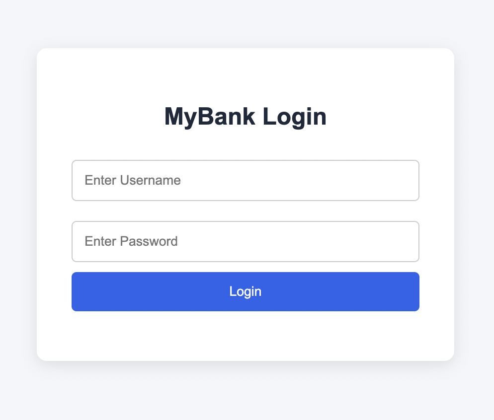
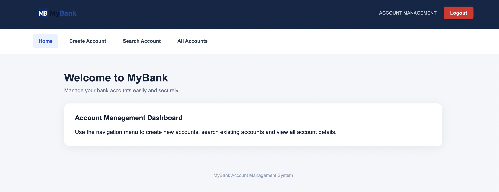
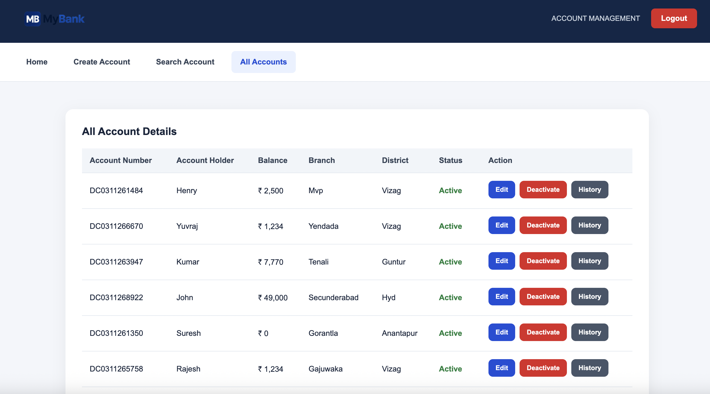
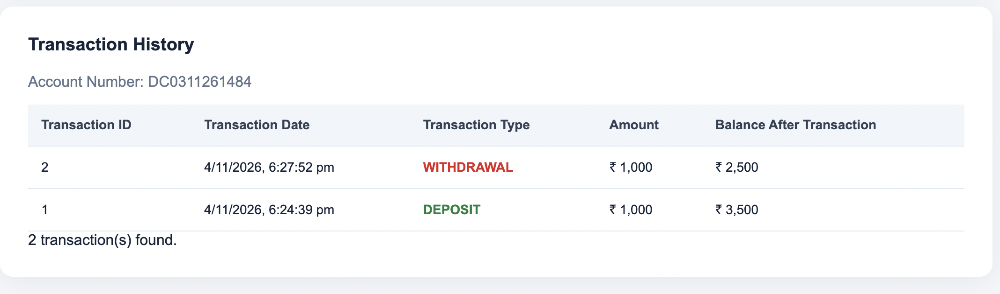

# WebDisplay – Banking Management System

A full-stack banking management application built using **Java 17, Spring Boot, Spring MVC, JSP, Hibernate and MySQL**. WebDisplay provides role-based banking operations, customer management, Helpdesk workflows, secure document processing, audit logging and session management.

---

## Application Screenshots

### Login Page


### Dashboard


### Account Management


### Transaction History


---

## User Roles

The application supports five application roles. The Helpdesk Manager is a supervisory designation within the Helpdesk role; the Bank Manager is a separate role.

| Role | Responsibilities |
|---|---|
| **Admin** | Staff management, audit history, application settings and global theme management. |
| **Bank Manager** | ID document verification, address-change approvals and banking oversight. |
| **Employee** | Customer management, account applications, account creation and permitted banking operations. |
| **Customer** | Account overview, transfers, beneficiaries, transaction history, statements, profile updates and support requests. |
| **Helpdesk** | Customer lookup, ticket handling, conversations, investigations and escalation workflows. The Helpdesk Manager supervises assignment and reassignment. |

---

## Key Features

### 1. Banking Operations
- Account creation with Savings or Current account type.
- Account activation and deactivation after verification.
- Deposits, withdrawals and fund transfers.
- Account balances and transaction history.
- Customer transaction filters for deposits, withdrawals and transfers.
- Date-range account statement viewing and PDF download.
- Beneficiary management and recipient account verification.
- One account per customer restriction.

### 2. Customer Management
- Customer profile and account management.
- Phone number and email updates with OTP verification.
- Address-change requests with supporting proof and bank approval.
- Customer-specific dashboards and transaction history.

### 3. Helpdesk and Ticket Management
- Create and manage customer support tickets.
- Customer lookup and account investigation.
- Raise tickets on behalf of customers who contact the bank by phone, email or branch visit.
- Tickets raised by Helpdesk agents are initially assigned to the creating agent.
- Helpdesk Manager assignment and reassignment workflows.
- Ticket status, priority, remarks, conversations and investigation history.
- Ticket statistics, filtering and SLA-based escalation.

### 4. Secure Document Upload
- Customer identity document and address-proof uploads.
- Supported formats: PDF, JPG, JPEG and PNG.
- Maximum file size: 5 MB.
- File extension, signature and structure validation.
- Malware scanning using **ClamAV**.
- PDF reconstruction and sanitisation using **Apache PDFBox**.
- Image decoding and re-encoding using **Java ImageIO**.
- Original and reconstructed documents undergo antivirus scanning.
- Fail-closed handling when antivirus scanning is unavailable.
- UUID-based filenames and private filesystem storage.
- Authenticated, role-authorised document viewing and verification.

### 5. Authentication and Session Security
- Custom session-based authentication filter.
- Role-based access control for all application roles.
- CSRF token validation for state-changing requests.
- Session ID regeneration after login.
- Session replacement detection and session invalidation.
- Logout and browser back-navigation protections.
- Session heartbeat and expiry handling.
- Mandatory password change for customers using temporary passwords.

### 6. Audit Logging
- AOP-based audit logging.
- Records important customer, account, employee and Helpdesk activities.
- Login, logout, failed-login and session replacement events.
- Administrative audit history for review.

### 7. Customer AI Assistant
- Floating customer support chat widget.
- Provides account, transaction, beneficiary and ticket information.
- Guides customers to relevant application features.
- Uses authenticated backend requests and session-based customer identity.
- Read-only: it does not transfer funds or modify customer data.
- Optional n8n integration for generative AI responses, with fallback to the built-in assistant.

### 8. Admin Theme Management
- Admin-controlled Light and Dark themes.
- Theme preview and global theme selection.
- Theme preference persisted in MySQL and applied across dashboards.

### 9. REST APIs and API Documentation
- REST APIs developed using Spring MVC.
- Layered controller, service and repository architecture.
- DTO-based data transfer and centralised exception handling.
- API documentation using **Springdoc OpenAPI** and Swagger UI.
- API documentation access restricted by application role checks.

### 10. Log Aggregation (Optional)
- Optional local **ELK Stack** configuration (Elasticsearch, Logstash and Kibana).
- Logstash can ingest multiple `.log` files from the application's `logs/` directory.
- Kibana provides a searchable view of collected application logs.
- ELK is separate from the Spring Boot runtime and is intended for local development in the provided configuration.

---

## Technology Stack

| Category | Technologies |
|---|---|
| Programming Language | Java 17 |
| Backend Framework | Spring Boot 4.1.2 |
| Web Framework | Spring MVC |
| Frontend | JSP, HTML, CSS, JavaScript |
| Persistence | Spring Data JPA |
| ORM | Hibernate |
| Database | MySQL |
| Authentication | Custom session authentication filter, CSRF protection |
| Antivirus | ClamAV |
| PDF Processing | Apache PDFBox 3.0.5 |
| Image Processing | Java ImageIO |
| API Documentation | Springdoc OpenAPI / Swagger |
| Optional AI Integration | n8n |
| Optional Log Aggregation | Elasticsearch, Logstash, Kibana |
| Build Tool | Maven |
| Development Tools | IntelliJ IDEA, VS Code, Postman |
| Version Control | Git and GitHub |

---

## Application Architecture

WebDisplay follows a layered architecture:

```text
              JSP / JavaScript UI
                      |
                      v
               Spring MVC Controllers
                      |
                      v
                 Service Layer
                      |
                      v
              Spring Data Repositories
                      |
                      v
                Hibernate ORM
                      |
                      v
                 MySQL Database
```

Supporting components include:
- **Session Authentication Filter:** validates sessions, roles and CSRF tokens.
- **Audit Layer:** records important application events using AOP.
- **Document Security Service:** validates, sanitises and scans uploaded documents.
- **Customer Assistant Service:** handles customer assistant requests and optional n8n integration.
- **Theme Service:** manages persistent application-wide theme settings.

---

## Database

WebDisplay uses MySQL with Spring Data JPA and Hibernate.

Main data areas include users and roles, customers, employees, accounts, transactions, beneficiaries, ID documents, address-change requests, support tickets, ticket conversations, audit logs, active sessions and application settings.

The application uses `spring.jpa.hibernate.ddl-auto=validate`; required database migrations must be applied before startup.

---

## Getting Started

### Prerequisites
- Java 17
- MySQL Server
- Git
- IntelliJ IDEA or VS Code
- ClamAV for document-upload scanning

Optional:
- Docker Desktop for the local ELK stack.
- n8n and an AI provider credential for optional generative AI integration.

### 1. Clone the Repository

```bash
git clone https://github.com/sathviksuhas7/WebDisplay.git
cd WebDisplay
```

### 2. Create the Database

```sql
CREATE DATABASE webdisplay_db;
```

Run the required SQL migration scripts against `webdisplay_db`:
- `database/remaining-work-migration.sql`
- `database/account-type-migration.sql`

### 3. Configure Environment Variables

Database configuration:

```text
DB_URL=jdbc:mysql://localhost:3306/webdisplay_db
DB_USERNAME=your_mysql_username
DB_PASSWORD=your_mysql_password
```

Document storage and antivirus configuration:

```text
DOCUMENT_UPLOAD_DIR=/path/to/private/document/storage
DOCUMENT_SCAN_ENABLED=true
CLAMAV_HOST=127.0.0.1
CLAMAV_PORT=3310
CLAMAV_TIMEOUT_MS=10000
```

ClamAV must be installed, its virus database updated and its daemon running for document uploads to work. Scanning is enabled by default; uploads are blocked if scanning is unavailable.

Optional n8n configuration:

```text
N8N_AI_WEBHOOK_URL=your_n8n_webhook_url
N8N_AI_SHARED_SECRET=your_shared_secret
```

Do not commit real credentials, secrets, private customer documents or local environment files to GitHub.

For detailed setup instructions, see `SECURITY-AND-INTEGRATION-SETUP.md`.

### 4. Build and Run

```bash
./mvnw clean compile
./mvnw spring-boot:run
```

### 5. Access the Application

Application:

```text
http://localhost:1111
```

Swagger UI:

```text
http://localhost:1111/swagger-ui.html
```

OpenAPI JSON:

```text
http://localhost:1111/v3/api-docs
```

Swagger access is restricted by the application's role checks.

---

## Optional ELK Setup

With Docker Desktop running, start Elasticsearch, Logstash and Kibana from the project root:

```bash
docker compose -f elk/docker-compose.yml up -d
```

Open Kibana at `http://localhost:5601` and create a data view for `webdisplay-logs-*`.

Stop the stack:

```bash
docker compose -f elk/docker-compose.yml down
```

The supplied ELK configuration disables Elasticsearch security and is for local development only. Do not expose it publicly or use it in production without authentication, TLS and appropriate access restrictions.

---

## Project Documentation

| File / Folder | Description |
|---|---|
| `SECURITY-AND-INTEGRATION-SETUP.md` | Database, ClamAV, API, AI and ELK setup. |
| `API-SERVICE-INVENTORY.md` | Service and REST controller inventory. |
| `COMPLETE-IMPLEMENTATION-CHECKLIST.md` | Implementation and testing checklist. |
| `LOCAL-VERIFICATION-REPORT.md` | Recorded verification results and limitations. |
| `WHAT-CHANGED-2026-11-19.md` | Summary of recent application changes. |
| `database/` | Database migration scripts. |
| `verification/` | SQL scripts for audit and legacy-data review. |
| `n8n/` | Optional customer AI assistant workflow. |
| `elk/` | Optional local ELK stack configuration. |

---

## Project Status

WebDisplay includes the core banking, customer management, Helpdesk, authentication, audit, document-security and dashboard functionality described above.

Development and verification are ongoing. End-to-end testing depends on the local MySQL database, ClamAV service, browser workflows and optional n8n/ELK configurations. Refer to `COMPLETE-IMPLEMENTATION-CHECKLIST.md` for remaining verification tasks.

---

## Author

**O Sathvik Suhas**

Java | Spring Boot | MySQL | Backend Development
